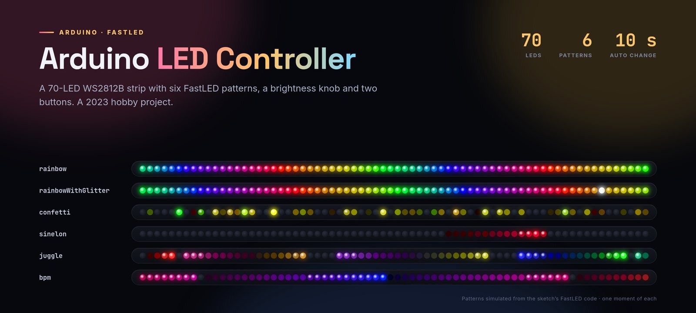

# Arduino LED Controller

**Six FastLED patterns on a 70-LED strip, with a brightness knob and two buttons.**

An LED light show for an Arduino and a WS2812B strip, built on FastLED's "DemoReel100" example by Mark Kriegsman. A 2023 hobby project.

- **Six patterns:** rainbow, rainbow with glitter, confetti, sinelon, juggle and BPM.
- **Automatic mode** (the default) moves to the next pattern every 10 seconds.
- **Brightness knob:** a potentiometer sets the brightness from 10 to 180 (out of 255).
- **Green button:** manual mode and the next pattern.
- **Blue button:** the whole strip white for 8 seconds.
- **Both buttons together:** back to automatic mode (the strip flashes green for 1 second).

## Hardware

- A 5 V Arduino board with A0 and A5 (the code assumes a 5 V reference)
- WS2812B LED strip, GRB colour order, 70 LEDs
- Potentiometer for brightness
- Two push buttons (green and blue)

### Wiring (from the code)

| Arduino pin | Goes to |
|---|---|
| D2 | LED strip data in |
| A5 | Potentiometer wiper (ends to 5 V and GND) |
| D5 | Green button, other side to GND (internal pull-up) |
| D4 | Blue button, other side to GND (internal pull-up) |
| A0 | Battery voltage (read, not used yet; see below) |
| GND | Strip GND, buttons, potentiometer |

## Setup

1. Install the **FastLED** library (Arduino IDE: Tools → Manage Libraries).
2. Open `led_controller_sketch.ino` (File → Open).
3. Tools → Board: pick your Arduino board.
4. Tools → Port: pick its port.
5. Click Upload.
6. Optional: open the Serial Monitor at **9600** to see the knob reading, brightness, buttons and auto mode.

The sketch waits 3 seconds at start-up before it lights the strip.

## Operation

- Turn the potentiometer to set the brightness.
- Press the **green** button to switch to manual mode and move to the next pattern. It moves on every time round the loop while the button is down, so a long press can skip more than one pattern.
- Press the **blue** button to light the whole strip white for 8 seconds. Nothing else responds during that time.
- Press **both** buttons together to go back to automatic mode. The strip flashes green for 1 second.
- In automatic mode the pattern changes every 10 seconds.

## Included LED patterns

1. Rainbow
2. Rainbow with Glitter
3. Confetti
4. Sinelon
5. Juggle
6. BPM (Beats per minute)

The banner above shows one simulated moment of each pattern, worked out from the sketch's FastLED code.

## Battery level monitoring (planned)

The sketch reads a battery voltage on A0 and sets up a 3.85 V low-voltage threshold and a 10-reading average, but it doesn't use them yet: there is no voltage reading or low-battery warning so far.

## Credits

The patterns come from FastLED's DemoReel100 example by Mark Kriegsman (December 2014).

## License

MIT License.
